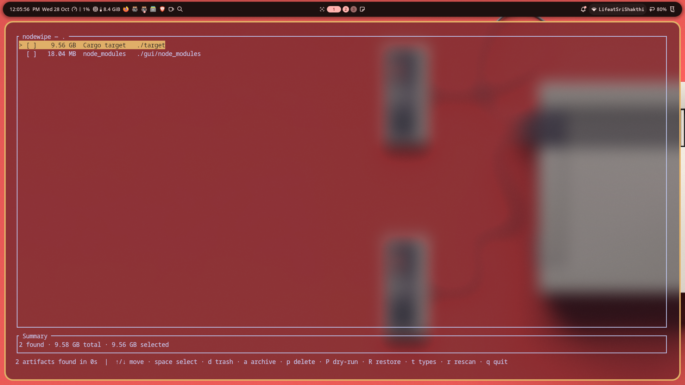
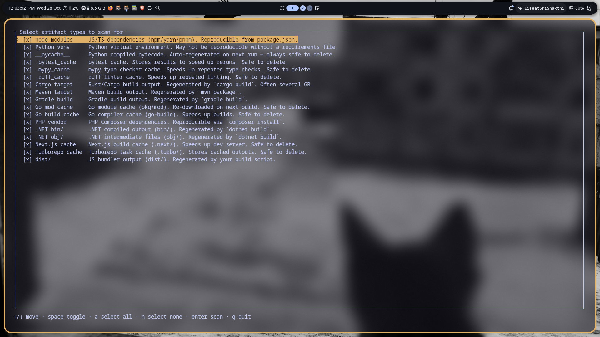
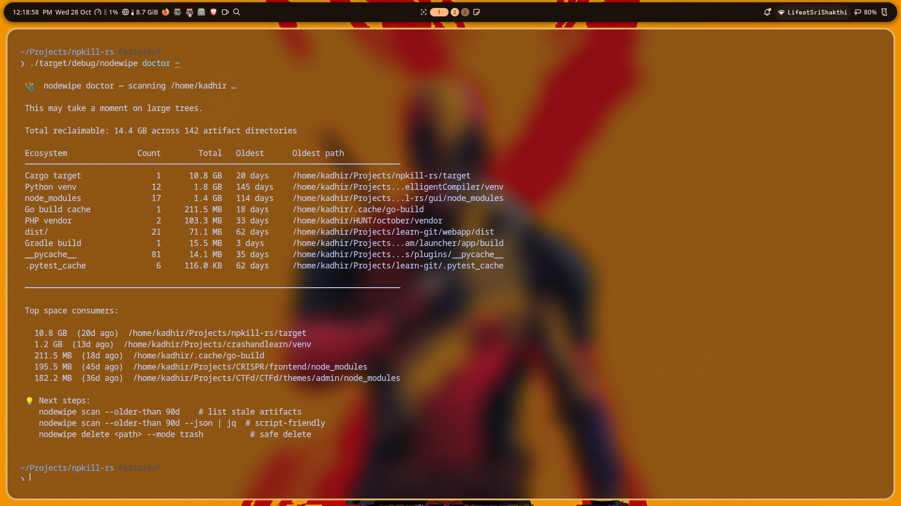
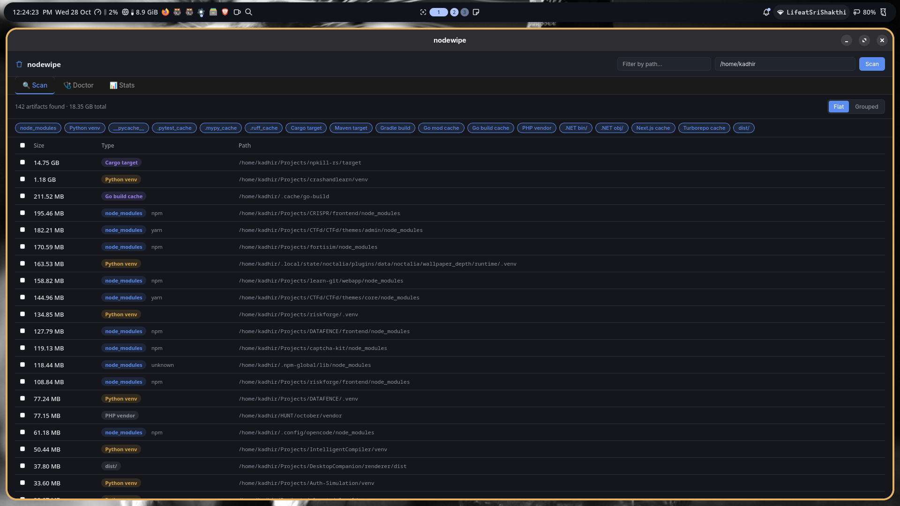
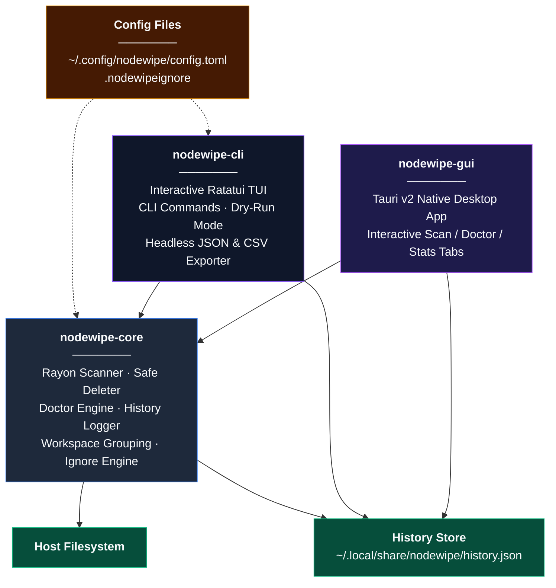

<div align="center">

  

  # nodewipe

  **The surgical, blazing-fast dev-environment cleaner written in Rust.**  
  *Reclaim tens of gigabytes from orphaned `node_modules`, Rust `target/`, Python `venv`s, and build caches across 17+ ecosystems.*

  <br>

  [](https://github.com/JOKER-53/nodewipe/releases)
  [](https://aur.archlinux.org/packages/nodewipe)
  [](https://www.npmjs.com/package/@joker53/nodewipe)
  [](LICENSE)
  [](https://github.com/JOKER-53/nodewipe/actions)

  <br><br>

  

  <br><br>

  [**Website & Live Demo**](https://joker53.me/nodewipe/) •
  [**Installation**](#-installation) •
  [**Key Features**](#-key-features) •
  [**Supported Ecosystems**](#-supported-ecosystems) •
  [**Interactive TUI**](#-interactive-tui--dry-run-mode) •
  [**System Doctor**](#-system-doctor-nodewipe-doctor) •
  [**Desktop GUI**](#-desktop-gui) •
  [**CLI Cheat Sheet**](#-cli-cheat-sheet)

</div>

---

## ⚡ Key Features

* **🚀 Blazingly Fast**: Parallel directory traversal and physical filesystem block analysis (`st_blocks * 512`) powered by `rayon`. Scans hundreds of thousands of folders in seconds.
* **🌐 17+ Ecosystems Covered**: Not just `node_modules` — handles Rust `target/`, Python `venv` / caches, Java Maven & Gradle, Go caches, .NET `bin/obj`, PHP `vendor`, Next.js, and Turborepo.
* **🛡️ Zero-Risk Excision**: Moves to OS Trash by default. Supports atomic `.tar.gz` archiving if you want a compressed rollback backup before removing.
* **🔍 Interactive TUI with Dry-Run Mode**: Full keyboard navigation, multi-select, and instant dry-run simulation (<kbd>P</kbd>) before touching a single byte.
* **🩺 System Doctor**: `nodewipe doctor ~` analyzes disk-hog distribution across every toolchain and identifies abandoned build outputs.
* **📦 Monorepo & Workspace Aware**: Automatically groups nested packages and monorepo roots (`pnpm`, `Cargo`, `Turborepo`, `Nx`).
* **📊 Lifetime Savings Dashboard**: Track every byte reclaimed over time (`nodewipe stats`) with a 30-day interactive history chart.
* **🖥️ Native Desktop GUI**: A lightweight, responsive Tauri desktop app wrapping the exact same high-speed Rust engine.

---

## 📦 Installation

Choose your preferred installation method:

### 1. NPM (No Rust toolchain required)
Installs a lightweight shim that automatically fetches the matching native binary for your OS and architecture:
```bash
# Run instantly with npx:
npx @joker53/nodewipe

# Or install globally:
npm install -g @joker53/nodewipe
```

### 2. Arch Linux (AUR)
Maintained in the official Arch User Repository:
```bash
yay -S nodewipe
# or: paru -S nodewipe
```

### 3. Universal Shell Installer
Interactive installer with support for CLI-only or CLI + Desktop GUI:
```bash
curl -fsSL https://raw.githubusercontent.com/JOKER-53/nodewipe/main/install.sh | bash
```

### 4. Docker
Run isolated scans without installing anything on your host machine:
```bash
# Scan current directory:
docker run --rm -v "$PWD":/scan ghcr.io/joker-53/nodewipe

# Interactive TUI inside Docker (requires TTY):
docker run --rm -it -v ~/Projects:/scan ghcr.io/joker-53/nodewipe scan
```

### 5. Build from Source (Cargo)
```bash
cargo build --release
./target/release/nodewipe
```

> [!TIP]
> Precompiled standalone binaries for **Linux (x86_64, aarch64)**, **macOS (Intel & Apple Silicon)**, and **Windows (x86_64)** are available on the [GitHub Releases page](https://github.com/JOKER-53/nodewipe/releases).

---

## 🌐 Supported Ecosystems

`nodewipe` uses strict **marker validation** to avoid false positives. A directory named `target`, `build`, or `dist` is only considered disposable if confirmed by sibling configuration files:

| Ecosystem | Artifact Name | Slug | Marker Validation |
|---|---|---|---|
| **Node.js** | `node_modules` | `node_modules` | Directory name (identifies `npm`, `yarn`, `pnpm` from lockfile) |
| **Python** | `venv`, `.venv` | `venv` | Contains `pyvenv.cfg` inside |
| **Python** | `__pycache__` | `pycache` | Directory name |
| **Python** | `.pytest_cache` | `pytest_cache` | Directory name |
| **Python** | `.mypy_cache` | `mypy_cache` | Directory name |
| **Python** | `.ruff_cache` | `ruff_cache` | Directory name |
| **Rust** | `target/` | `rust_target` | Sibling `Cargo.toml` exists |
| **Java** | `target/` | `maven_target` | Sibling `pom.xml` exists |
| **Java** | `build/` | `gradle_build` | Sibling `build.gradle` or `build.gradle.kts` exists |
| **Go** | `pkg/mod` | `go_mod_cache` | Sibling `go.mod` or `go.sum` exists |
| **Go** | `go-build/` | `go_build_cache` | Directory name (`.cache/go-build`) |
| **PHP** | `vendor/` | `php_vendor` | Sibling `composer.json` exists |
| **.NET** | `bin/` | `dotnet_bin` | Sibling `*proj` project file exists |
| **.NET** | `obj/` | `dotnet_obj` | Sibling `*proj` project file exists |
| **Next.js** | `.next` | `next_cache` | Directory name |
| **Turborepo**| `.turbo` | `turbo_cache` | Directory name |
| **Bundlers**| `dist/` | `dist` | Sibling `package.json` or `pyproject.toml` exists |

List all supported types and slugs at any time with:
```bash
nodewipe types
```

---

## 💻 Interactive TUI & Dry-Run Mode

Launching `nodewipe` with no arguments in a terminal opens the **Ratatui-powered interactive TUI**:

<div align="center">
  
</div>

### TUI Keyboard Shortcuts

| Key | Action |
|---|---|
| <kbd>↑</kbd> / <kbd>↓</kbd> or <kbd>k</kbd> / <kbd>j</kbd> | Move cursor up / down |
| <kbd>Space</kbd> | Toggle selection for the focused directory |
| <kbd>a</kbd> | Select all / Deselect all |
| <kbd>d</kbd> | **Delete to Trash** (Recoverable via OS recycle bin) |
| <kbd>Shift + a</kbd> | **Archive & Delete** (Creates `.tar.gz` backup adjacent to directory) |
| <kbd>p</kbd> | **Permanent Delete** (Unrecoverable — prompts for confirmation) |
| <kbd>P</kbd> | **Toggle Dry-Run Preview Mode** (Simulate recovery with zero risk) |
| <kbd>R</kbd> | Restore an archived backup file |
| <kbd>r</kbd> | Rescan current path |
| <kbd>q</kbd> / <kbd>Esc</kbd> | Quit nodewipe |

### Dry-Run Simulation Mode

Press <kbd>P</kbd> at any time in the TUI to activate **Dry-Run Mode**. It calculates the exact amount of space you would free and verifies file access without deleting or moving anything:

<div align="center">
  
</div>

---

## 🩺 System Doctor (`nodewipe doctor`)

Analyze where your storage is disappearing across all developer environments. `nodewipe doctor` scans recursively, computes aggregate totals by ecosystem, and surfaces the oldest untouched artifacts:

```bash
nodewipe doctor ~
```

<div align="center">
  
</div>

```text
 🩺  nodewipe doctor — scanning /home/kadhir …

 Total reclaimable: 14.4 GB across 142 artifact directories

 Ecosystem               Count        Total   Oldest      Oldest path
 ────────────────────────────────────────────────────────────────────────────────
 Cargo target                1      10.8 GB   20 days     /home/kadhir/Projects/npkill-rs/target
 Python venv                12       1.8 GB  145 days     /home/kadhir/Projects/.../venv
 node_modules               17       1.4 GB  114 days     /home/kadhir/Projects/.../node_modules
 Go build cache              1     211.5 MB   18 days     /home/kadhir/.cache/go-build
 PHP vendor                  2     103.3 MB   33 days     /home/kadhir/HUNT/october/vendor
 dist/                      21      71.1 MB   62 days     /home/kadhir/Projects/.../dist
 Gradle build                1      15.5 MB    3 days     /home/kadhir/Projects/.../build
 __pycache__                81      14.1 MB   35 days     /home/kadhir/Projects/.../__pycache__
 .pytest_cache               6     116.0 KB   62 days     /home/kadhir/Projects/.../.pytest_cache
 ────────────────────────────────────────────────────────────────────────────────

 Top space consumers:
   10.8 GB  (20d ago)  /home/kadhir/Projects/npkill-rs/target
    1.2 GB  (13d ago)  /home/kadhir/Projects/crashandlearn/venv
   211.5 MB (18d ago)  /home/kadhir/.cache/go-build
```

---

## 🖥️ Desktop GUI

`nodewipe` includes an optional native desktop application built with **Tauri v2** and Vanilla JS for near-zero memory footprint:

```bash
nodewipe gui
```

<div align="center">
  
</div>

* **🔍 Scan Tab**: Real-time path filtering, ecosystem filter chips, sortable columns, and collapsible monorepo tree view.
* **🩺 Doctor Tab**: High-level ecosystem breakdown table and top disk hogs.
* **📊 Stats Tab**: Visual bar chart of historical savings over the last 30 days.

---

## 📊 Lifetime Stats (`nodewipe stats`)

Every deletion made through the CLI, TUI, or GUI is recorded to `~/.local/share/nodewipe/history.json`. Review your all-time disk savings with:

```bash
nodewipe stats
```

```text
📊  nodewipe stats — lifetime savings

 Total freed:  23.7 GB across 63 deletions

 By ecosystem:
 ────────────────────────────────────────────────────────
  node_modules          31     340.2 MB   last: today
  rust_target           12      14.2 GB   last: 3 days ago
  python_venv            9       2.1 GB   last: 14 days ago

 Last 30 days:
  2026-08-20  ████████████████  2.1 GB (4 deletions)
  2026-08-23  ████              512 MB (1 deletion)
  2026-08-27  ████████████████████████  340.2 MB (1 deletion)
```

---

## 📖 CLI Cheat Sheet

```bash
# ── Scanning ────────────────────────────────────────────────────────────────
nodewipe scan                              # Scan current directory
nodewipe scan ~/Projects                   # Scan specific path
nodewipe scan ~ --min-mb 100               # Only surface artifacts >= 100 MB
nodewipe scan ~ --grouped                  # Group by monorepo/workspace root
nodewipe scan ~ --sort age                 # Sort oldest to newest
nodewipe scan ~ --older-than 30d           # Only show artifacts untouched for 30+ days
nodewipe scan ~ --stale-days 60            # Flag projects with source untouched in 60+ days
nodewipe scan ~ --preset python            # Scan only Python artifacts (node, rust, java, go)
nodewipe scan ~ --exclude-types venv,dist  # Skip specific types
nodewipe scan ~ --export audit.csv         # Export results to CSV or JSON
nodewipe scan ~ --json                     # Headless JSON output for CI/automation

# ── Deleting & Restoring ───────────────────────────────────────────────────
nodewipe delete ./path/node_modules --yes                 # Safe delete (OS Trash)
nodewipe delete ./path/target --mode archive --yes       # Compressed tar.gz backup + delete
nodewipe delete ./path/venv --mode permanent --yes       # Immediate permanent delete
nodewipe delete ./path/node_modules --dry-run            # Preview deletion impact
nodewipe restore ./path/app-target-backup.tar.gz         # Restore an archived backup

# ── Analysis & Tooling ──────────────────────────────────────────────────────
nodewipe doctor ~                          # Run system-wide disk-hog analysis
nodewipe stats                             # Lifetime savings breakdown and bar chart
nodewipe types                             # List all supported artifact types & slugs
nodewipe man --install                     # Install system man page (~/.local/share/man/man1/)
nodewipe completions bash > ~/.local/share/bash-completion/completions/nodewipe
nodewipe gui                               # Launch desktop GUI
```

---

## ⚙️ Configuration

### `.nodewipeignore`
Place a `.nodewipeignore` file in your scan root (or in `~/.nodewipeignore` for global defaults). Supports standard `.gitignore` glob syntax:

```gitignore
# Ignore legacy projects or critical directories
archive/**
apps/production-app/node_modules
!apps/experimental/node_modules
```

Bypass ignore files with `--no-ignore-file`.

### Global Config (`~/.config/nodewipe/config.toml`)
```toml
# Set default deletion mode: "trash" | "archive" | "permanent"
default_delete_mode = "trash"

# Types to automatically exclude from all scans
default_exclude_types = ["venv", "rust_target"]
```

---

## 🥊 Comparison with npkill

`nodewipe` was built to address long-standing limitations in original Node-based cleanup utilities:

| Feature / Issue | `npkill` | `nodewipe` |
|---|:---:|:---:|
| **Language & Engine** | Node.js (V8 runtime) | **Pure Rust (`rayon` multithreaded)** |
| **Supported Ecosystems** | `node_modules` only | **17+ (Node, Rust, Python, Java, Go, .NET, PHP, Caches)** |
| **Disk Size Accuracy** | Logical byte sum | **Physical cluster block calculation (`st_blocks`)** |
| **Safety & Recovery** | Permanent unlink only | **OS Trash + Atomic `.tar.gz` Archiving** |
| **Interactive Dry-Run** | ❌ No | **✅ Real-time simulation toggle (<kbd>P</kbd>)** |
| **Monorepo / Workspace Support**| Flat results flood screen | **Automatic grouping by detected workspace root** |
| **Scriptable Headless Mode** | ❌ No | **`--json`, `--yes`, `--export csv/json`, exit codes** |
| **System Doctor Analysis** | ❌ No | **`nodewipe doctor` (Ecosystem breakdown & staleness)** |
| **Lifetime History Tracking** | ❌ No | **`nodewipe stats` (Dashboard & historical bar chart)** |
| **Native Desktop App** | ❌ No | **Tauri v2 Desktop GUI (`nodewipe gui`)** |

---

## 🏗️ Architecture



---

## 🤝 Contributing

Contributions, issues, and feature requests are welcome!

1. Fork the repository
2. Create your feature branch (`git checkout -b feature/awesome-feature`)
3. Ensure all tests pass: `cargo test --workspace`
4. Commit your changes (`git commit -m "feat: add awesome feature"`)
5. Push to your branch (`git push origin feature/awesome-feature`)
6. Open a Pull Request

---

## 📄 License

This project is licensed under the [MIT License](LICENSE).
Developed and maintained by [**JOKER-53**](https://github.com/JOKER-53).
