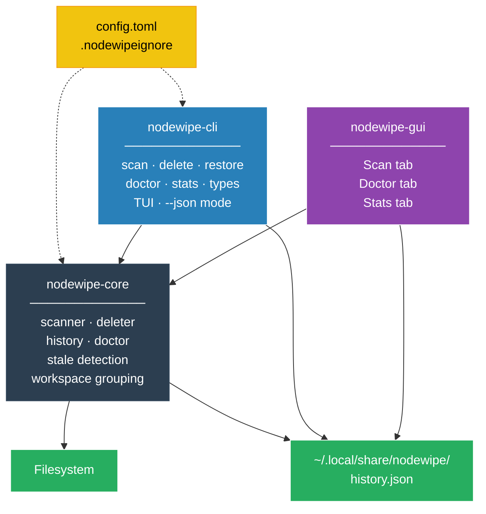

# nodewipe

```
 _   _           _    __        ___            
| \ | | ___   __| | __\ \      / (_)_ __   ___ 
|  \| |/ _ \ / _` |/ _ \ \ /\ / /| | '_ \ / _ \
| |\  | (_) | (_| |  __/\ V  V / | | |_) |  __/
|_| \_|\___/ \__,_|\___| \_/\_/  |_| .__/ \___|
                                   |_|         
```

A Rust dev-environment cleanup tool. Started as a reimagining of
[npkill](https://github.com/voidcosmos/npkill) (see the issue-to-fix mapping
below), but goes further: `node_modules` isn't the only thing that quietly
eats disk space — Python virtualenvs, `__pycache__`, Rust `target/`, Java/Gradle
build output, and JS bundler caches all have the exact same problem. nodewipe
scans for all of them by default, through one shared engine.

## Supported artifact types

| Type | Slug | Detected by |
|---|---|---|
| `node_modules` | `node_modules` | directory name |
| Python venv | `venv` | `venv`/`.venv` name + `pyvenv.cfg` inside |
| Python bytecode cache | `pycache` | `__pycache__` |
| pytest cache | `pytest_cache` | `.pytest_cache` |
| mypy cache | `mypy_cache` | `.mypy_cache` |
| ruff cache | `ruff_cache` | `.ruff_cache` |
| Rust build output | `rust_target` | `target/` + sibling `Cargo.toml` |
| Maven build output | `maven_target` | `target/` + sibling `pom.xml` |
| Gradle build output | `gradle_build` | `build/` + sibling `build.gradle(.kts)` |
| Next.js cache | `next_cache` | `.next` |
| Turborepo cache | `turbo_cache` | `.turbo` |
| JS bundler output | `dist` | `dist/` + sibling `package.json` |

Everything is scanned by default (`nodewipe scan`); opt individual types out
with `nodewipe --exclude-types venv,dist`, or list them all with `nodewipe types`.
Ambiguous names like `target`/`build`/`dist` are only matched when a marker
file confirms the ecosystem (e.g. `target/` next to `Cargo.toml`), so an
unrelated folder that happens to share the name is never touched.

## Installing

```bash
# 1. npm — downloads the right native binary via postinstall,
#    no Rust/Node build step for the end user
npx @joker53/nodewipe
# or: npm install -g @joker53/nodewipe

# 2. Arch Linux (AUR)
yay -S nodewipe
# or: paru -S nodewipe

# 3. Docker — scan any folder without installing anything
docker run --rm -v "$PWD":/scan ghcr.io/kadhiravaneg/nodewipe
# Scan a specific directory:
docker run --rm -v ~/Projects:/scan ghcr.io/kadhiravaneg/nodewipe scan --json
# Interactive TUI inside Docker (needs a TTY):
docker run --rm -it -v ~/Projects:/scan ghcr.io/kadhiravaneg/nodewipe scan

# 4. Shell installer — asks CLI-only vs CLI+GUI
curl -fsSL https://raw.githubusercontent.com/KADHIRAVANEG/nodewipe/main/install.sh | bash

# 5. Manual — grab the binary for your platform from GitHub Releases
#    https://github.com/KADHIRAVANEG/nodewipe/releases
```

None of these compile anything locally — `.github/workflows/release.yml` builds
native binaries for Linux/macOS/Windows on every version tag and attaches them
to a GitHub Release; the npm package and `install.sh` just fetch the matching
one.

### Publishing a new release

```bash
git tag vX.Y.Z
git push origin vX.Y.Z
```

This triggers the GitHub Actions workflow to build and attach binaries. The npm
shim only needs re-publishing when its own code changes:

```bash
cd npm-package
npm version patch   # or minor/major
npm publish --access=public
```

## Building from source

```bash
cargo build --release
./target/release/nodewipe scan
```

## Building the GUI

Requires Node.js/npm in addition to Rust, plus Tauri's native dependencies:
- **Linux**: `webkit2gtk-4.1`, `libappindicator-gtk3`, `librsvg`, and build tools
- **macOS**: Xcode Command Line Tools (`xcode-select --install`)
- **Windows**: Microsoft C++ Build Tools + WebView2

```bash
cd gui
npm install
npm run dev      # dev mode with hot reload
npm run build    # distributable bundle
```

## Usage (CLI)

```bash
# Interactive TUI (default when run in a terminal)
nodewipe

# Scan current directory
nodewipe scan

# Scan a specific directory
nodewipe scan ~
nodewipe scan ~/Projects

# Only show artifacts >= 50 MB
nodewipe scan ~ --min-mb 50

# Group results by monorepo/workspace root
nodewipe scan ~ --grouped

# Sort by age — oldest (most abandoned) artifacts float to the top
nodewipe scan ~ --sort age

# Flag projects whose source files haven't been touched in 60+ days
nodewipe scan ~ --stale-days 60

# Only show artifacts untouched in 30+ days
nodewipe scan ~ --older-than 30d
# Also accepts w(eeks), m(onths ~30d), y(ears ~365d): --older-than 6m

# Skip specific artifact types
nodewipe scan --exclude-types venv,dist,rust_target

# List every supported type and its slug
nodewipe types

# Scriptable / CI mode
nodewipe scan --json > report.json

# Delete: safe by default (moves to OS trash), requires --yes
nodewipe delete ./apps/foo/node_modules --yes

# Archive before deleting (creates a .tar.gz backup)
nodewipe delete ./apps/foo/node_modules --mode archive --yes

# Preview only — no changes made
nodewipe delete ./apps/foo/node_modules --dry-run

# Restore a backup created by --mode archive
nodewipe restore ./apps/foo/foo-node_modules-backup.tar.gz

# Generate shell completions (e.g. bash, zsh, fish, powershell)
nodewipe completions bash > ~/.local/share/bash-completion/completions/nodewipe

# Launch the desktop GUI
nodewipe gui
```

## Analysis commands

### `nodewipe doctor`

Scans your system and gives a full breakdown of disk usage by ecosystem —
how many Rust `target/` folders, Python venvs, etc., how much space each
ecosystem takes in total, and which artifact is the oldest (most abandoned).

```bash
nodewipe doctor ~
```

Example output:
```
🩺  nodewipe doctor — scanning /home/user …

 Total reclaimable: 16.0 GB across 90 artifact directories

 Ecosystem               Count        Total   Oldest      Oldest path
 ────────────────────────────────────────────────────────────────────────────────
 Cargo target                2      13.7 GB   51 days     ~/npkill-rs/target
 Python venv                 4       1.7 GB   82 days     ~/Downloads/.../venv
 node_modules                6     491.7 MB   69 days     ~/fortisim/.../node_modules
 Go build cache              1      70.0 MB   32 days     ~/.cache/go-build
 __pycache__                75       4.1 MB   121 days    ~/Downloads/.../__pycache__

 Top space consumers:
   12.3 GB  (51d ago)  ~/npkill-rs/target
   1.6 GB   (1d ago)   ~/CRISPR/.venv
   1.4 GB   (35d ago)  ~/linuxpet/target

 💡 Next steps:
    nodewipe scan --older-than 90d
    nodewipe delete <path> --mode trash
```

### `nodewipe stats`

Shows a dashboard of how much disk space you have freed over time, broken
down by ecosystem, with a bar chart of the last 30 days. History is stored
in `~/.local/share/nodewipe/history.json`.

```bash
nodewipe stats
```

Example output:
```
📊  nodewipe stats — lifetime savings

 Total freed:  23.7 GB   across 63 deletions

 By ecosystem:
 ────────────────────────────────────────────────────────
  node_modules          31     340.2 MB   last: today
  rust_target           12      14.2 GB   last: 3 days ago
  python_venv            9       2.1 GB   last: 14 days ago

 Last 30 days:
  2026-08-20  ████████████████  2.1 GB (4 deletions)
  2026-08-23  ████              512 MB (1 deletion)
  2026-08-27  ████████████████████████  340.2 MB (1 deletion)

 All-time total: 16.5 GB
```

## Persistent config

### `.nodewipeignore`

Drop a `.nodewipeignore` file in a scan root (or `~/.nodewipeignore` for a
global rule set) to permanently skip specific paths. This file supports standard
`.gitignore` glob syntax (powered by the standard `ignore` crate):

```
# .nodewipeignore
legacy-project/
apps/**/node_modules
!apps/keep-this-one/node_modules
```

Disable for a single run with `--no-ignore-file`.

### Config file

`~/.config/nodewipe/config.toml` sets defaults that CLI flags always override:

```toml
default_delete_mode = "archive"          # trash | archive | permanent
default_exclude_types = ["venv", "rust_target"]
```

## GUI

The Tauri desktop app (`nodewipe gui`) wraps the same `nodewipe-core` engine
as the CLI. It has three tabs:

- **🔍 Scan** — search/filter, per-type filter chips, flat and collapsible
  grouped (monorepo) views, sortable columns, select-all, colored type
  badges, confirmation modal for permanent delete, toast notifications.
- **🩺 Doctor** — ecosystem breakdown table and top space consumers for the
  scanned folder.
- **📊 Stats** — per-ecosystem deletion history and 30-day bar chart.

All deletions made through the GUI are recorded to the same history file as
the CLI, so `nodewipe stats` reflects GUI deletions too.

## Issue-to-fix mapping (voidcosmos/npkill)

| npkill issue | What this project does differently |
|---|---|
| #188 no headless/scriptable mode | `--json` output + `--yes`/`--dry-run` flags + proper exit codes |
| #199 / #191 nested directory bugs | Scanner prunes recursion only at matched artifact; sibling branches are never affected |
| #104 no grouped/collapsed view | `workspace::group_by_workspace` groups by detected monorepo root |
| #172 / #121 slow scan/delete | `rayon`-parallel directory walk and parallel size computation |
| #60 no trash/undo | `DeleteMode::Trash` moves to OS trash instead of unlinking |
| #46 no archive option | `DeleteMode::Archive` tars+gzips before removing |
| #75 pnpm/Windows issues | Package manager detected from lockfile; `.pnpm` treated as part of one deletable unit |
| #186 no desktop app | `gui/` — Tauri app wrapping the same `nodewipe-core` engine |

## Roadmap

1. ✅ Core scanning + deletion engine, scriptable CLI
2. ✅ Interactive terminal UI with `ratatui`, multi-select, trash/archive/permanent
3. ✅ Tauri GUI wrapping `nodewipe-core` (no engine code duplicated)
4. ✅ Multi-ecosystem support (Python, Rust, Java, JS build caches), risk warnings
5. ✅ Prebuilt binaries/installers via GitHub Actions for macOS/Linux/Windows, npm shim, `install.sh`
6. ✅ `.nodewipeignore`, `~/.config/nodewipe/config.toml`, `restore`, `--older-than` age filtering
7. ✅ AUR package (`nodewipe`), npm package (`@joker53/nodewipe`)
8. ✅ `nodewipe doctor` — ecosystem analysis and disk-hog report
9. ✅ `nodewipe stats` — lifetime deletion dashboard with history tracking
10. ✅ Last-used sorting (`--sort age`) and stale project detection (`--stale-days`)
11. ✅ GUI Doctor and Stats tabs
12. ✅ Shell completions (bash/zsh/fish/powershell)
13. ✅ Self-update check and automatic download for prebuilt binaries
14. Homebrew tap + Scoop/winget packages
15. Benchmark suite vs. npkill on a large monorepo fixture

## Project layout

```
nodewipe/
├── core/          # nodewipe-core: engine — scanner, deleter, history, doctor, stale detection
├── cli/           # nodewipe-cli: argument parsing, output formatting, TUI
├── gui/           # nodewipe-gui: Tauri desktop app
│   ├── src-tauri/ # Rust backend (Tauri commands)
│   └── web/       # Vanilla JS + CSS frontend
├── npm-package/   # npm shim — downloads the right native binary on install
├── packaging/
│   └── aur/       # Arch Linux AUR PKGBUILD
└── docker/        # Docker image
```

## Architecture


